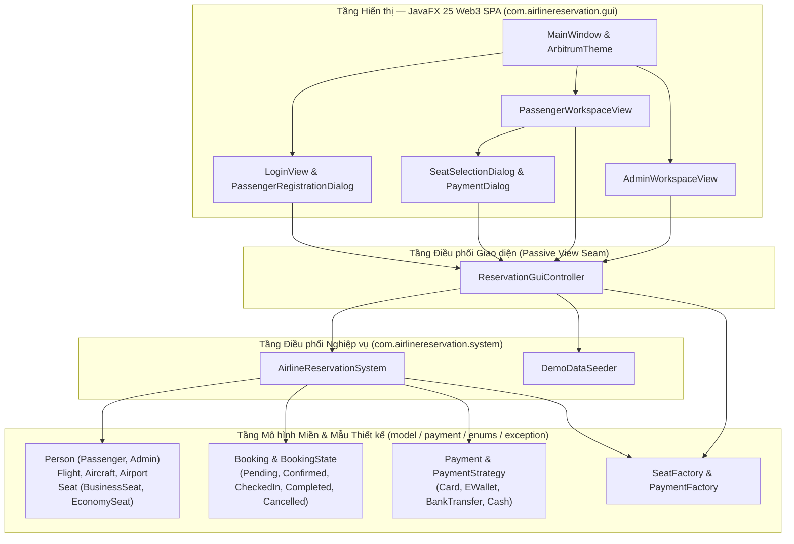
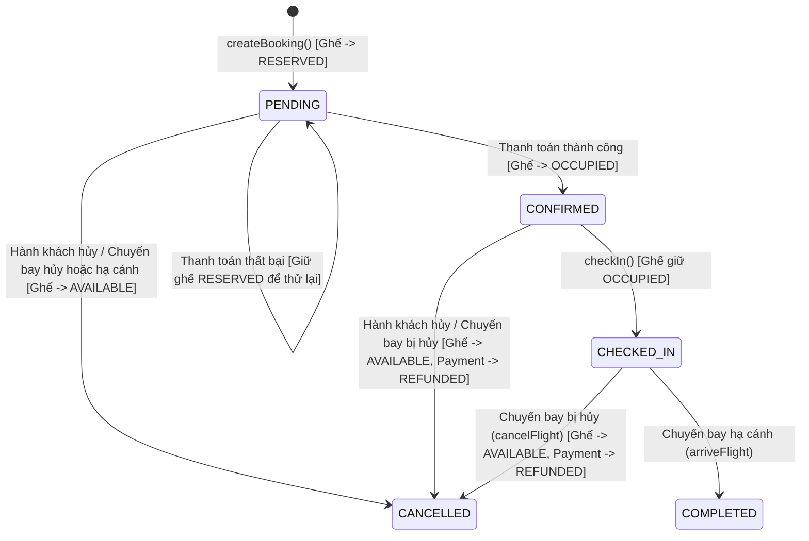

# Airline Reservation System — Hệ thống Đặt vé Máy bay (Đề tài 21)

Hệ thống quản lý lịch trình chuyến bay, đội tàu bay, sơ đồ khoang ghế đa hạng, hồ sơ hành khách, quy trình đặt chỗ theo máy trạng thái (State Machine) và cổng thanh toán đa phương thức, đi kèm giao diện **JavaFX 25 Web3 SPA** lấy cảm hứng từ hệ thống thiết kế **Arbitrum** ([DESIGN.md](DESIGN.md)).

---

## Mục lục
1. [Yêu cầu Môi trường & Công nghệ](#1-yêu-cầu-môi-trường--công-nghệ)
2. [Hướng dẫn Khởi chạy Nhanh (Quick Start)](#2-hướng-dẫn-khởi-chạy-nhanh-quick-start)
3. [Tài khoản Demo & Dữ liệu Khởi tạo](#3-tài-khoản-demo--dữ-liệu-khởi-tạo)
4. [Kiến trúc Hệ thống & Cấu trúc Thư mục](#4-kiến-trúc-hệ-thống--cấu-trúc-thư-mục)
5. [Thiết kế OOP, SOLID & Design Patterns](#5-thiết-kế-oop-solid--design-patterns)
6. [Vòng đời Trạng thái (State Machines & Cascades)](#6-vòng-đời-trạng-thái-state-machines--cascades)
7. [Hướng dẫn Sử dụng Giao diện JavaFX](#7-hướng-dẫn-sử-dụng-giao-diện-javafx)
8. [Quy ước Phát triển dành cho Thành viên Nhóm](#8-quy-ước-phát-triển-dành-cho-thành-viên-nhóm)

---

## 1. Yêu cầu Môi trường & Công nghệ

- **JDK**: Java **25** (`maven.compiler.release = 25`)
- **UI Framework**: **JavaFX 25.0.1** (`org.openjfx:javafx-controls`)
- **Testing**: **JUnit 5 (Jupiter 5.12.2)** — 85 bài kiểm thử tự động
- **Build Tool**: **Maven Wrapper** tích hợp sẵn (`./mvnw` trên macOS/Linux, `.\mvnw.cmd` trên Windows — không cần cài đặt Maven thủ công)

---

## 2. Hướng dẫn Khởi chạy Nhanh (Quick Start)

### 2.1. Chạy Giao diện Đồ họa JavaFX (Khuyên dùng)

Trên **Windows (PowerShell / CMD)**:
```powershell
.\mvnw.cmd javafx:run
```

Trên **macOS / Linux**:
```bash
./mvnw javafx:run
```

*(Hoặc chạy từ `Main` với cờ `--gui`: `.\mvnw.cmd compile exec:java -Dexec.mainClass="com.airlinereservation.Main" -Dexec.args="--gui"`)*

### 2.2. Chạy Kịch bản Console Smoke Run (Milestone 4)

Chạy tự động 6 luồng nghiệp vụ cốt lõi (Tìm chuyến -> Đặt ghế -> Thanh toán thử lại & xác nhận -> Check-in -> Hủy vé/Hủy chuyến hoàn tiền -> Hạ cánh chuyến bay) trên terminal:
```powershell
.\mvnw.cmd compile exec:java -Dexec.mainClass="com.airlinereservation.Main"
```

### 2.3. Chạy Toàn bộ Bộ Kiểm thử Đơn vị (Unit Tests)

```powershell
.\mvnw.cmd test
```

---

## 3. Tài khoản Demo & Dữ liệu Khởi tạo

Khi ứng dụng khởi động (hoặc khi nhấn nút **`Reset Demo`** trên thanh điều hướng), lớp [`DemoDataSeeder`](src/main/java/com/airlinereservation/system/DemoDataSeeder.java) tự động nạp sẵn danh mục sân bay, tàu bay, chuyến bay và các tài khoản mẫu sau:

### 3.1. Tài khoản Đăng nhập Mẫu

> **Mẹo trên màn hình Login**: Bạn có thể **click 1 lần** vào các chip tài khoản mẫu để tự động điền thông tin, hoặc **double-click** vào chip để đăng nhập ngay lập tức.

| Vai trò | Mã định danh (`ID`) | Email / Mã NV | CCCD / Hộ chiếu | Mật khẩu | Ghi chú dữ liệu mẫu |
| :--- | :--- | :--- | :--- | :--- | :--- |
| **Passenger 1** | `PAX-01` | `an.nguyen@airline.vn` | `CCCD-0001` | `pass123` | Có sẵn 2 đơn đặt chỗ: `BK-1` (`CONFIRMED` trên `VN101`) và `BK-2` (`PENDING` trên `VN103`) |
| **Passenger 2** | `PAX-02` | `binh.tran@airline.vn` | `CCCD-0002` | `pass123` | Tài khoản trắng để thử nghiệm đặt ghế và thanh toán mới |
| **Admin** | `ADM-01` | `STF-001` / `admin@airline.vn` | — | `admin123` | Toàn quyền điều phối chuyến bay, đổi trạng thái bay và giám sát hệ thống |

### 3.2. Danh mục Chuyến bay & Tàu bay Mẫu

- **Sân bay (`Airport`)**: `HAN` (Nội Bài - Hà Nội), `SGN` (Tân Sơn Nhất - TP.HCM), `DAD` (Đà Nẵng)
- **Tàu bay (`Aircraft`)**:
  - `AC-320` — Airbus `A320neo` (16 ghế: 4 ghế Business hàng 1, 4 ghế Economy+ Extra Legroom hàng 2, 8 ghế Economy hàng 3–4)
  - `AC-787` — Boeing `787-9 Dreamliner` (20 ghế: 4 ghế Business hàng 1, 4 ghế Economy+ Extra Legroom hàng 2, 12 ghế Economy hàng 3–5)
- **Chuyến bay (`Flight`)** (Ngày mặc định: `2026-12-15`):
  - `FL-01` (`VN101`): `HAN -> SGN` (08:00 – 10:15) · `A320neo` · Giá cơ sở `1,500,000 VND`
  - `FL-02` (`VN103`): `HAN -> SGN` (14:00 – 16:15) · `787-9 Dreamliner` · Giá cơ sở `1,850,000 VND`
  - `FL-03` (`VN205`): `SGN -> DAD` (`2026-12-16` 09:30 – 10:50) · `A320neo` · Giá cơ sở `1,200,000 VND`

---

## 4. Kiến trúc Hệ thống & Cấu trúc Thư mục

Hệ thống tuân thủ kiến trúc phân tầng **MVC / Passive View** ([ADR-0005](docs/adr/0005-swing-mvc-presenter-architecture.md), [ADR-0006](docs/adr/0006-javafx-view-migration.md)): toàn bộ giao diện JavaFX hoàn toàn tách biệt khỏi miền nghiệp vụ thông qua bộ điều phối `ReservationGuiController`.



### Cấu trúc Thư mục Mã nguồn

```text
e:\OOP
├── DESIGN.md                                  # Đặc tả hệ thống thiết kế Arbitrum Web3 SPA
├── GLOSSARY.md                                # Từ điển thuật ngữ miền (Ubiquitous Language)
├── docs/
│   └── adr/                                   # Architecture Decision Records (ADR-0001 -> ADR-0006)
├── diagrams/                                  # Sơ đồ lớp PlantUML (.puml, .svg, .png)
├── src/
│   ├── main/
│   │   ├── java/com/airlinereservation/
│   │   │   ├── Main.java                      # Điểm vào Console Smoke Run (hoặc --gui)
│   │   │   ├── AirlineReservationApp.java     # Điểm vào khởi chạy JavaFX
│   │   │   ├── enums/                         # BookingStatus, FlightStatus, PaymentMethod, PaymentStatus, SeatStatus
│   │   │   ├── exception/                     # Hệ thống ngoại lệ miền (AirlineReservationException & 6 lớp con)
│   │   │   ├── model/                         # Thực thể miền, SeatFactory và các lớp BookingState
│   │   │   ├── payment/                       # PaymentStrategy, PaymentFactory và 4 lớp chiến lược thanh toán
│   │   │   ├── system/                        # AirlineReservationSystem & DemoDataSeeder
│   │   │   └── gui/                           # Giao diện JavaFX 25 & ReservationGuiController
│   │   └── resources/com/airlinereservation/gui/
│   │       ├── arbitrum-theme.css             # Bảng kiểu CSS JavaFX chuẩn Arbitrum
│   │       └── fonts/                         # Bộ font nhúng (Aeonik, FK Screamer, DM Mono)
│   └── test/java/com/airlinereservation/      # 85 bài kiểm thử JUnit 5 phủ toàn bộ miền & GUI controller
└── pom.xml
```

---

## 5. Thiết kế OOP, SOLID & Design Patterns

Các quyết định kiến trúc cốt lõi của nhóm được ghi nhận chi tiết trong thư mục [`docs/adr/`](docs/adr/):

1. **Kế thừa & Đa hình trên Sơ đồ Ghế ([ADR-0001](docs/adr/0001-per-flight-seat-composition.md))**:
   - Lớp trừu tượng [`Seat`](src/main/java/com/airlinereservation/model/Seat.java) định nghĩa phương thức trừu tượng `calculatePrice(double basePrice)`.
   - [`BusinessSeat`](src/main/java/com/airlinereservation/model/BusinessSeat.java): Nhân giá cơ sở với `priceMultiplier` (mặc định `2.0x`) và đi kèm quyền lợi phòng chờ (`hasLoungeAccess`).
   - [`EconomySeat`](src/main/java/com/airlinereservation/model/EconomySeat.java): Giá tiêu chuẩn (`1.0x`) hoặc cộng phụ phí chỗ để chân rộng `Extra Legroom` (`1.15x` ở hàng Economy đầu tiên).
   - Mỗi `Flight` sở hữu riêng một sơ đồ `Seat` (quan hệ **Composition**), cô lập hoàn toàn trạng thái ghế giữa các chuyến bay dùng chung một chiếc `Aircraft`.
2. **Strategy Pattern cho Thanh toán ([ADR-0002](docs/adr/0002-payment-strategy-abstraction.md))**:
   - Giao diện [`PaymentStrategy`](src/main/java/com/airlinereservation/payment/PaymentStrategy.java) tách rời thuật toán xác thực/thanh toán khỏi bản ghi [`Payment`](src/main/java/com/airlinereservation/model/Payment.java).
   - Hỗ trợ 4 chiến lược: `CardPayment`, `EWalletPayment`, `BankTransferPayment` và `CashPayment` (tuân thủ **Open/Closed Principle** — có thể thêm phương thức mới mà không sửa đổi `Booking` hay `AirlineReservationSystem`).
3. **State Pattern cho Vòng đời Đặt chỗ ([ADR-0004](docs/adr/0004-state-and-factory-deepening.md))**:
   - Giao diện [`BookingState`](src/main/java/com/airlinereservation/model/BookingState.java) cùng 5 lớp trạng thái (`PendingBookingState`, `ConfirmedBookingState`, `CheckedInBookingState`, `CompletedBookingState`, `CancelledBookingState`) đóng gói toàn bộ quy tắc chuyển trạng thái, giữ/nhả ghế và phản ứng trước sự kiện chuyến bay.
4. **Factory Pattern ([ADR-0004](docs/adr/0004-state-and-factory-deepening.md))**:
   - [`SeatFactory`](src/main/java/com/airlinereservation/model/SeatFactory.java): Tự động phân bổ tỷ lệ ghế Thương gia (20% sức chứa cho tàu bay từ 5 ghế trở lên), hàng ghế `Economy+ Extra Legroom` và ghế `Economy` tiêu chuẩn theo cấu hình 4 ghế/hàng (`A`, `B`, `C`, `D`).
   - [`PaymentFactory`](src/main/java/com/airlinereservation/payment/PaymentFactory.java): Khởi tạo đồng bộ cặp `Payment` và `PaymentStrategy`.
5. **Hệ thống Ngoại lệ Miền Unchecked ([ADR-0003](docs/adr/0003-unchecked-domain-exceptions.md))**:
   - Kế thừa từ [`AirlineReservationException`](src/main/java/com/airlinereservation/exception/AirlineReservationException.java): `ValidationException`, `EntityNotFoundException`, `DuplicateEntityException`, `SeatNotAvailableException`, `InvalidStateException`, `PaymentException`.

---

## 6. Vòng đời Trạng thái (State Machines & Cascades)

### 6.1. Vòng đời Đơn đặt chỗ (`BookingStatus`) & Ghế (`SeatStatus`)



### 6.2. Vòng đời Chuyến bay (`FlightStatus`) & Hiệu ứng Dây chuyền (Cascades)

- Luồng chuyển trạng thái hợp lệ của chuyến bay:
  - `SCHEDULED -> BOARDING -> DEPARTED -> ARRIVED`
  - `SCHEDULED -> CANCELLED` hoặc `BOARDING -> CANCELLED` *(Chuyến bay đã `DEPARTED` hoặc `ARRIVED` không thể hủy).*
- **Khi Admin đánh dấu `ARRIVED` (`arriveFlight`)**:
  - Các đơn `CHECKED_IN` tự động chuyển sang `COMPLETED`.
  - Các đơn `PENDING` (chưa thanh toán) tự động bị `CANCELLED` và nhả ghế về `AVAILABLE`.
  - Các đơn `CONFIRMED` nhưng không check-in (No-show) giữ nguyên trạng thái `CONFIRMED`.
- **Khi Admin đánh dấu `CANCELLED` (`cancelFlight`)**:
  - Mọi đơn đang hoạt động (`PENDING`, `CONFIRMED`, `CHECKED_IN`) trên chuyến bay đó đều chuyển sang `CANCELLED`, trả toàn bộ ghế về `AVAILABLE`, và mọi giao dịch `Payment` đã `COMPLETED` đều tự động chuyển sang `REFUNDED`.

---

## 7. Hướng dẫn Sử dụng Giao diện JavaFX

### 7.1. Luồng dành cho Hành khách (`Passenger Workspace`)
1. **Đăng nhập / Đăng ký**:
   - Double-click vào chip **`PAX-01 · Passenger`** hoặc **`PAX-02 · Passenger`** trên màn hình đăng nhập, hoặc nhấn **`Create Passenger Account`** để tạo tài khoản mới (hệ thống **tự động cấp phát mã `Passenger ID`** tiếp theo như `PAX-03`, `PAX-04`... mà người dùng không cần tự nhập, đồng thời có nút **`Auto-Fill Sample`** hỗ trợ điền nhanh dữ liệu mẫu).
2. **Tìm kiếm Chuyến bay (`Search & Book Flights`)**:
   - Chọn sân bay đi (`From`), sân bay đến (`To` — dùng nút **`⇄`** để đảo chiều nhanh), ngày bay và số lượng ghế, sau đó nhấn **`Search Flights`**. Nhấn **`All Scheduled`** để xem lại toàn bộ chuyến bay đang mở bán.
3. **Chọn ghế trên Sơ đồ Khoang Máy bay (`SeatSelectionDialog`)**:
   - Double-click vào một dòng chuyến bay hoặc nhấn **`Select Seats · <FlightNo>`**.
   - Chọn một hoặc nhiều ghế trống trên sơ đồ thân máy bay (`2 - Lối đi - 2`). Hệ thống tính tổng giá vé trực tiếp theo từng hạng ghế (`Business 2.0x`, `Economy+ 1.15x`, `Economy 1.0x`).
   - Nhấn **`Hold Seats (Pay Later)`** để giữ chỗ (`PENDING`), hoặc nhấn **`Reserve & Pay Now`** để chuyển thẳng sang cổng thanh toán.
4. **Thanh toán, Check-in & Hủy vé (`My Bookings`)**:
   - Chọn đơn `PENDING` và nhấn **`Pay Booking`** (hoặc double-click vào dòng đơn). Bạn có thể tích chọn **`Simulate Payment Failure`** để kiểm thử luồng thanh toán lỗi (đơn vẫn giữ ghế `PENDING`), sau đó bỏ tích để thanh toán lại thành công (`CONFIRMED`).
   - Khi đơn ở trạng thái `CONFIRMED`, nhấn **`Check In`** (hoặc double-click vào dòng đơn) để chuyển sang `CHECKED_IN`.
   - Nhấn **`Cancel Booking`** trên đơn `PENDING` hoặc `CONFIRMED` để hủy chỗ (tự động nhả ghế và hoàn tiền `REFUNDED` nếu đã thanh toán).

### 7.2. Luồng dành cho Quản trị viên (`Admin Operations Console`)
1. **Đăng nhập Admin**: Double-click vào chip **`ADM-01 · Admin`** trên màn hình đăng nhập.
2. **Tab `Flight Operations`**:
   - **Lên lịch chuyến bay mới**: Nhấn **`Suggest Next ID`** để tự động điền mã chuyến bay tiếp theo, chọn sân bay đi/đến, tàu bay (`A320neo` hoặc `787-9 Dreamliner`), giờ khởi hành/hạ cánh, giá vé cơ sở và nhấn **`Schedule Flight`**.
   - **Điều khiển vòng đời chuyến bay**: Chọn một chuyến bay trong bảng. Các nút **`Mark Boarding`**, **`Mark Departed`**, **`Mark Arrived`** và **`Cancel Flight`** sẽ tự động bật/tắt tương ứng với trạng thái hợp lệ tiếp theo của chuyến bay đang chọn.
3. **Tab `Booking Ledger` & `Passenger Registry`**:
   - Theo dõi 4 chỉ số vận hành thời gian thực (**Total Flights**, **Total Bookings**, **Registered Passengers**, **Settled Revenue**) cùng toàn bộ lịch sử đặt chỗ, trạng thái thanh toán/hoàn tiền và danh sách hành khách trên toàn hệ thống.

---

## 8. Quy ước Phát triển dành cho Thành viên Nhóm

Để giữ mã nguồn thống nhất và không làm hỏng các bài kiểm thử tự động:

1. **Tuân thủ Thuật ngữ Miền**: Sử dụng đúng tên lớp và thuật ngữ đã định nghĩa trong [`GLOSSARY.md`](GLOSSARY.md) (ví dụ: dùng `Passenger` thay vì `Customer`, `Flight` thay vì `Trip`, `Booking` thay vì `Order`).
2. **Giữ ranh giới Passive View**:
   - Không gọi trực tiếp các phương thức thay đổi trạng thái miền từ lớp View mà phải đi qua [`ReservationGuiController`](src/main/java/com/airlinereservation/gui/ReservationGuiController.java).
   - Không đưa các thành phần đồ họa JavaFX (`Stage`, `Scene`, `Node`) vào bên trong `ReservationGuiController` hay các lớp `model`/`system`/`payment` để đảm bảo bộ test chạy tốt trên môi trường headless.
3. **Quy chuẩn Giao diện & CSS**:
   - Mọi chỉnh sửa giao diện cần tuân thủ bảng màu và font chữ trong [`DESIGN.md`](DESIGN.md) và [`arbitrum-theme.css`](src/main/resources/com/airlinereservation/gui/arbitrum-theme.css).
   - Luôn chạy `.\mvnw.cmd test` sau khi sửa file `.css` hoặc `.java` để đảm bảo [`ArbitrumThemeTest`](src/test/java/com/airlinereservation/gui/ArbitrumThemeTest.java) xác nhận file CSS không có lỗi cú pháp JavaFX (`CssParser`).
