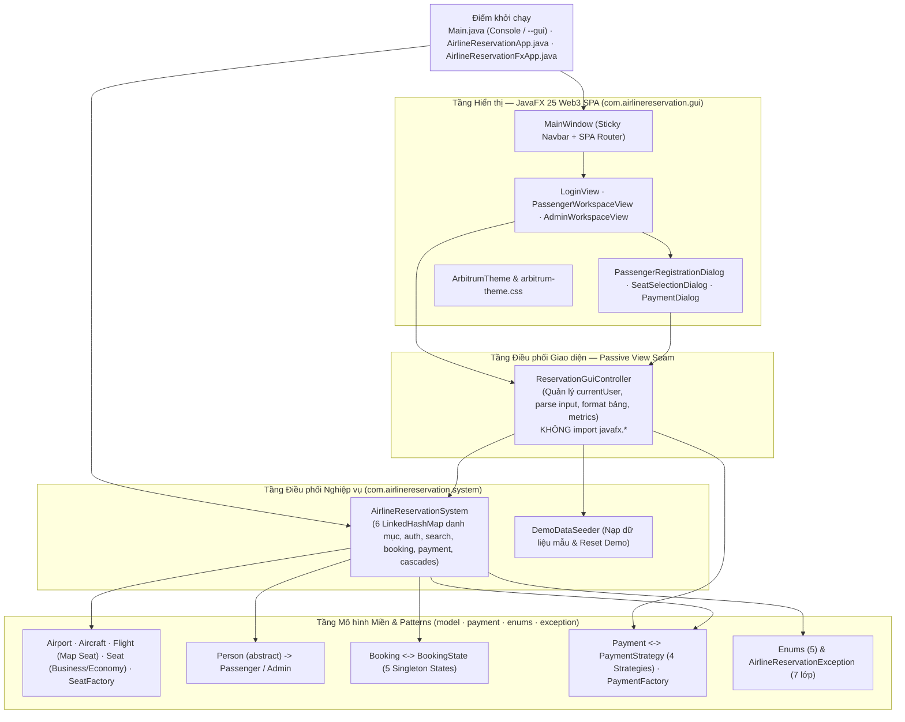
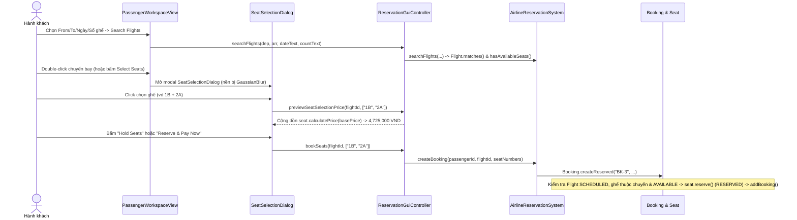
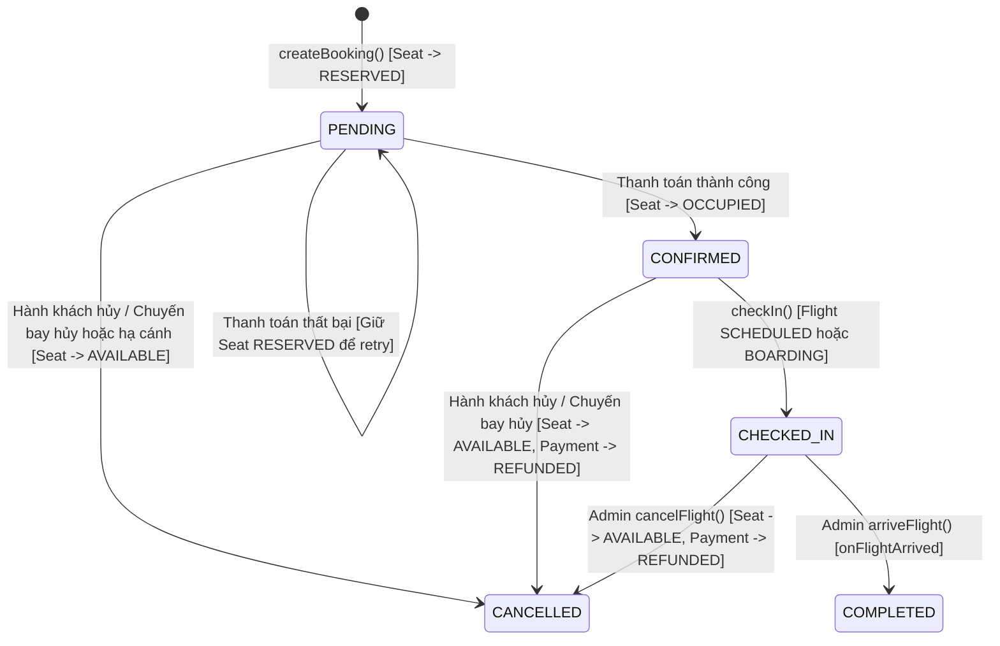

# Cẩm nang Nền tảng Kỹ thuật, Kiến trúc & Codebase — Airline Reservation System (Đề tài 21)

> **Dành cho ai?** Thành viên Nhóm 4 (`D24CQCE05`) đã nắm kiến thức OOP cơ bản từ **Chương 1 đến Chương 6** (biến, mảng/chuỗi, class/object, đóng gói cơ bản, exception cơ bản, file I/O, kế thừa/đa hình/abstract/interface cơ bản) và muốn hiểu **100% dự án** để tự tin đọc code, sửa lỗi và bảo vệ Milestone 6.
>
> **Cách đọc hiệu quả:** Đọc tuần tự từ **Phần 1 → Phần 2 → Phần 3**, sau đó dùng **Phần 4** như bản đồ tra cứu từng file Java trong repo.

---

## Mục lục

1. [Bản đồ Kiến thức: Từ Chương 6 đến Milestone 6](#1-bản-đồ-kiến-thức-từ-chương-6-đến-milestone-6)
2. [Chuẩn bị & Chạy thử Dự án trên Máy](#2-chuẩn-bị--chạy-thử-dự-án-trên-máy)
3. [Phần 1 — Tất cả Kiến thức Nền tảng (Fundamentals) Dự án Sử dụng](#3-phần-1--tất-cả-kiến-thức-nền-tảng-fundamentals-dự-án-sử-dụng)
   - [3.1. Maven, Maven Wrapper & Java 25](#31-maven-maven-wrapper--java-25)
   - [3.2. Các cú pháp Java cốt lõi ngoài Chương 6 (`enum`, `java.time`, `record`, `switch ->`, Pattern Matching)](#32-các-cú-pháp-java-cốt-lõi-ngoài-chương-6)
   - [3.3. Nâng cao Chương 4: Unchecked Exceptions & Kiểm tra biên (ADR-0003)](#33-nâng-cao-chương-4-unchecked-exceptions--kiểm-tra-biên-adr-0003)
   - [3.4. Chương 7: Generics & Java Collections Framework](#34-chương-7-generics--java-collections-framework)
   - [3.5. Chương 7.5: Functional Interface, Anonymous Class, Lambda & Stream API](#35-chương-75-functional-interface-anonymous-class-lambda--stream-api)
   - [3.6. Chương 6 nâng cao & Chương 10: Quan hệ giữa các lớp trong UML & Java](#36-chương-6-nâng-cao--chương-10-quan-hệ-giữa-các-lớp-trong-uml--java)
   - [3.7. Chương 10.5: Nguyên lý SOLID & 3+1 Design Patterns trong Dự án](#37-chương-105-nguyên-lý-solid--31-design-patterns-trong-dự-án)
   - [3.8. Chương 9 & ADR-0005/0006: Kiến trúc Passive View MVC & JavaFX 25](#38-chương-9--adr-00050006-kiến-trúc-passive-view-mvc--javafx-25)
   - [3.9. Kiểm thử tự động với JUnit 5](#39-kiểm-thử-tự-động-với-junit-5)
4. [Phần 2 — Kiến trúc Hệ thống & Ranh giới các Tầng](#4-phần-2--kiến-trúc-hệ-thống--ranh-giới-các-tầng)
5. [Phần 3 — Luồng Hoạt động Cốt lõi (End-to-End Workflows)](#5-phần-3--luồng-hoạt-động-cốt-lõi-end-to-end-workflows)
6. [Phần 4 — Bản đồ Toàn bộ Codebase & Chi tiết Từng Module](#6-phần-4--bản-đồ-toàn-bộ-codebase--chi-tiết-từng-module)
7. [Bộ 10 Câu hỏi Tự kiểm tra trước khi Bảo vệ](#7-bộ-10-câu-hỏi-tự-kiểm-tra-trước-khi-bảo-vệ)

---

## 1. Bản đồ Kiến thức: Từ Chương 6 đến Milestone 6

Trong môn `INT1332_CLC`, từ Chương 1 đến Chương 6 bạn đã học nền tảng Java và OOP cơ bản. Project Milestone 6 sử dụng thêm kiến thức của các chương sau (Chương 7 → 10.5) cùng vài tính năng Java hiện đại và JavaFX 25:

| Đã biết (Chương 1–6) | Project nâng cấp lên thành gì? | Nơi xuất hiện tiêu biểu trong Repo |
| :--- | :--- | :--- |
| Chạy file đơn lẻ `javac` / `java` | **Maven Wrapper (`mvnw.cmd`) & `pom.xml`** tự tải thư viện JavaFX 25, JUnit 5 và đóng gói chạy lệnh 1 dòng | [`pom.xml`](../pom.xml) |
| Hằng số bằng `int` hoặc `String` dễ gõ nhầm | **`enum`** giới hạn tập giá trị hợp lệ lúc biên dịch | Package `enums` (5 file) |
| `try-catch`, `extends Exception` (Checked) | **`RuntimeException` (Unchecked)** + hàm kiểm tra tĩnh `ValidationException.requireNonBlank(...)` | Package `exception` (7 file), [ADR-0003](adr/0003-unchecked-domain-exceptions.md) |
| Mảng cố định `Seat[]` (Chương 3) | **`List<T>`**, **`LinkedHashMap<K, V>`**, **`HashSet<T>`**, **`List.copyOf(...)`**, **Generics `<T>`** | `AirlineReservationSystem`, `Flight`, `Booking`, `SeatFactory` |
| Vòng `for` lọc/tính tổng truyền thống | **`@FunctionalInterface`**, **Lambda (`->`)**, **Method Reference (`::`)**, **Stream API** | `PaymentStrategy`, `Booking.calculateTotalPrice()`, `ReservationGuiController` |
| Kế thừa `extends` & `implements` cơ bản | **6 quan hệ UML** (đặc biệt **Composition vs Association**) | `Flight`–`Seat` vs `Flight`–`Aircraft`, [ADR-0001](adr/0001-per-flight-seat-composition.md) |
| `if-else` / `switch-case` xử lý mọi thứ trong 1 class | **SOLID** + **State, Strategy, Factory Pattern** (+ Singleton nhẹ cho State) | `BookingState` (5 lớp), `PaymentStrategy` (4 lớp), `SeatFactory`, `PaymentFactory` |
| Nhập/xuất Console (`Scanner`, `System.out`) | **JavaFX 25 SPA + CSS (`arbitrum-theme.css`) + Passive View MVC** | Package `gui` (12 file), [ADR-0005](adr/0005-swing-mvc-presenter-architecture.md), [ADR-0006](adr/0006-javafx-view-migration.md) |
| Chạy hàm `main()` tự nhìn màn hình kiểm tra | **85 bài Unit/Integration Test JUnit 5** tự động kiểm tra cả logic lẫn CSS/GUI | `src/test/java/` (22 file test) |

---

## 2. Chuẩn bị & Chạy thử Dự án trên Máy

Mở PowerShell tại thư mục gốc `e:\OOP`:

```powershell
# 1. Chạy toàn bộ 85 bài kiểm thử tự động (JUnit 5)
.\mvnw.cmd test

# 2. Chạy kịch bản Console tự động (Milestone 4 smoke run - 6 luồng nghiệp vụ)
.\mvnw.cmd compile exec:java -Dexec.mainClass="com.airlinereservation.Main"

# 3. Chạy Giao diện Đồ họa JavaFX 25 (Milestone 6 Final Product)
.\mvnw.cmd javafx:run
```

> **Mẹo:** Bạn không cần cài Maven trước. File `mvnw.cmd` (Windows) hoặc `./mvnw` (macOS/Linux) sẽ tự động dùng Maven Wrapper chuẩn của dự án. Yêu cầu máy cài sẵn **JDK 25**.

**Tài khoản có sẵn khi mở app (do [`DemoDataSeeder`](../src/main/java/com/airlinereservation/system/DemoDataSeeder.java) nạp tự động):**

| Vai trò | ID đăng nhập | Email / Mã NV | CCCD | Mật khẩu | Trạng thái ban đầu |
| :--- | :--- | :--- | :--- | :--- | :--- |
| **Passenger 1** | `PAX-01` | `an.nguyen@airline.vn` | `CCCD-0001` | `123456` *(hoặc click chip)* | Có sẵn `BK-1` (`CONFIRMED`, `VN101` ghế `1A`) & `BK-2` (`PENDING`, `VN103` ghế `2A, 2B`) |
| **Passenger 2** | `PAX-02` | `binh.tran@airline.vn` | `CCCD-0002` | `123456` | Tài khoản trắng — rất tiện để demo đặt vé mới |
| **Admin** | `ADM-01` | `admin@airline.vn` / `STF-001` | — | `admin123` | Toàn quyền mở chuyến, đổi trạng thái bay & xem doanh thu |

> **Lưu ý nhỏ về mật khẩu mặc định:** `Person.DEFAULT_PASSWORD` trong [`Person.java`](../src/main/java/com/airlinereservation/model/Person.java) là `"123456"` (lưu ý `README.md` có ghi nhầm mẫu `pass123`, nhưng code thật trong `Person.java` và `ReservationGuiController.java` dùng `Person.DEFAULT_PASSWORD = "123456"`). Trên màn hình Login, bấm **1 lần** vào chip demo để điền sẵn đúng tài khoản/mật khẩu, hoặc **double-click** để đăng nhập ngay.

---

## 3. Phần 1 — Tất cả Kiến thức Nền tảng (Fundamentals) Dự án Sử dụng

### 3.1. Maven, Maven Wrapper & Java 25

- **Maven** là công cụ quản lý dự án Java chuẩn công nghiệp. Thay vì bạn phải tự lên mạng tải file `.jar` của JavaFX hay JUnit rồi add tay vào IDE, ta chỉ cần khai báo trong [`pom.xml`](../pom.xml):
  - `<maven.compiler.release>25</maven.compiler.release>` → Biên dịch theo chuẩn **Java 25**.
  - `org.openjfx:javafx-controls:25.0.1` → Thư viện giao diện **JavaFX 25**.
  - `org.junit.jupiter:junit-jupiter:5.12.2` → Thư viện kiểm thử **JUnit 5** (chỉ dùng khi test, `<scope>test</scope>`).
- **Quy ước thư mục chuẩn Maven**:
  - `src/main/java/...` → Mã nguồn chạy thật của ứng dụng.
  - `src/main/resources/...` → Tài nguyên đi kèm (file CSS `arbitrum-theme.css` và 4 file font `.otf`/`.ttf`).
  - `src/test/java/...` → Mã nguồn kiểm thử JUnit 5 (cấu trúc package soi gương với `src/main/java`).

---

### 3.2. Các cú pháp Java cốt lõi ngoài Chương 6

#### (a) `enum` — Kiểu liệt kê an toàn
Thay vì lưu trạng thái đơn đặt chỗ bằng chuỗi `"PENDING"` (dễ gõ sai thành `"PEDNING"` mà trình biên dịch không báo lỗi), Java dùng `enum`:

```java
// File: enums/BookingStatus.java
public enum BookingStatus {
    PENDING,
    CONFIRMED,
    CHECKED_IN,
    COMPLETED,
    CANCELLED
}
```
Khi gán `BookingStatus.PENDING`, Java đảm bảo chỉ có đúng 5 giá trị này tồn tại. Trong project có 5 enum: `BookingStatus`, `FlightStatus`, `SeatStatus`, `PaymentMethod`, `PaymentStatus`.

#### (b) `java.time` (`LocalDate`, `LocalDateTime`, `Clock`)
- `LocalDate`: chỉ lưu **ngày** (`2026-12-15`) — dùng cho ngày sinh của `Passenger`, ngày bay khi tìm kiếm.
- `LocalDateTime`: lưu **ngày + giờ phút** (`2026-12-15T08:00`) — dùng cho giờ cất cánh/hạ cánh của `Flight`, thời điểm tạo `Booking` (`createdAt`), thời điểm thanh toán (`paidAt`).
- `Clock`: có thể bạn thấy lạ khi `AirlineReservationSystem` và `Payment` nhận tham số `Clock`. Mục đích rất đơn giản: bình thường app dùng `Clock.systemDefaultZone()` (giờ hệ thống thật), nhưng khi viết Unit Test cần cố định thời gian (ví dụ test `paidAt` đúng bằng `2026-11-14T10:00`), test truyền vào `Clock.fixed(...)` để kết quả không phụ thuộc lúc chạy test!

#### (c) `record` (Java 16+) — Lớp dữ liệu bất biến viết gọn
Ở Chương 2, để tạo 1 class chỉ dùng để gom vài dữ liệu (như 3 con số thống kê), bạn phải viết field `private final`, constructor, getter, `equals`, `hashCode`, `toString` dài 40–50 dòng. Với `record`, Java tự sinh toàn bộ những thứ đó chỉ trong **1 dòng**:

```java
// File: gui/ReservationGuiController.java
public record PortalMetrics(int airportsCount, int scheduledFlightsCount, int availableSeatsCount) {
}
```
Khi dùng, gọi `metrics.airportsCount()` (tên hàm getter trùng tên trường, không có chữ `get`). Project dùng `record` ở: `DemoAccount`, `PortalMetrics`, `AdminMetrics`, `SeatPresentation` (trong `SeatSelectionDialog`), `MethodSpec` (trong `PaymentDialog`).

#### (d) Pattern Matching cho `instanceof` & Switch Expression (Java 14–16+)
- **Trước đây (Chương 6):**
  ```java
  if (currentUser instanceof Passenger) {
      Passenger passenger = (Passenger) currentUser; // phải ép kiểu thủ công
      return passenger;
  }
  ```
- **Trong code hiện đại của project (`ReservationGuiController.java`):**
  ```java
  if (!(currentUser instanceof Passenger passenger)) {
      throw new ValidationException("Passenger login is required for this action");
  }
  return passenger;
  ```
  Nếu `currentUser` là `Passenger`, Java tự ép kiểu vào biến `passenger` ngay trong biểu thức!
- **Switch Expression (`->`)**: Thay cho `switch-case` có `break` dễ quên, trả về giá trị trực tiếp và bắt buộc đủ mọi nhánh enum:
  ```java
  // File: gui/ReservationGuiController.java
  return switch (method) {
      case CREDIT_DEBIT_CARD -> PaymentFactory.createCardPayment(primaryDetail, secondaryDetail);
      case E_WALLET -> PaymentFactory.createEWalletPayment(primaryDetail, secondaryDetail);
      case BANK_TRANSFER -> PaymentFactory.createBankTransferPayment(primaryDetail, secondaryDetail);
      case CASH -> PaymentFactory.createCashPayment(primaryDetail, secondaryDetail);
  };
  ```

---

### 3.3. Nâng cao Chương 4: Unchecked Exceptions & Kiểm tra biên (ADR-0003)

Ở Chương 4, bạn đã biết có 2 nhánh ngoại lệ chính dưới `Throwable`:
1. **Checked Exception (`extends Exception`)**: Trình biên dịch **ép** mọi hàm gọi tới nó phải viết `throws ...` hoặc bọc `try-catch`.
2. **Unchecked Exception (`extends RuntimeException`)**: Trình biên dịch **không ép** khai báo `throws`, nhưng khi lỗi xảy ra lúc chạy, chương trình vẫn ném ngoại lệ lên tầng trên để xử lý.

**Tại sao nhóm chọn Unchecked Exception (`ADR-0003`)?**
Nếu dùng Checked Exception:
- Các biểu thức Java Stream như `.filter(s -> ...)` hay `@FunctionalInterface` `PaymentStrategy.pay(double)` sẽ bị **vỡ cú pháp** (vì interface không khai báo `throws CheckedException`).
- Mọi hàm trung gian từ `Booking` → `AirlineReservationSystem` → `ReservationGuiController` đều bị "ô nhiễm" bởi chuỗi `throws` dài dòng.

Do đó, toàn bộ hệ thống lỗi nghiệp vụ kế thừa từ lớp gốc [`AirlineReservationException`](../src/main/java/com/airlinereservation/exception/AirlineReservationException.java) (`extends RuntimeException`):

| Lớp ngoại lệ con | Ý nghĩa | Ví dụ tình huống ném lỗi |
| :--- | :--- | :--- |
| `ValidationException` | Dữ liệu đầu vào rỗng, null, âm, sai định dạng ngày, sai mật khẩu, sai quyền | Tên chuyến bay rỗng, giá `<= 0`, sân bay đi = sân bay đến, ngày không theo `YYYY-MM-DD` |
| `EntityNotFoundException` | Không tìm thấy đối tượng theo ID/mã | Tìm `FL-99` không có, ghế `9Z` không tồn tại trên chuyến bay |
| `DuplicateEntityException` | Trùng khóa chính hoặc giấy tờ định danh | Đăng ký trùng `PAX-01`, trùng số `CCCD-0001`, trùng mã sân bay `HAN` |
| `SeatNotAvailableException` | Ghế không còn trống hoặc ghế thuộc chuyến bay khác | Đặt ghế `1A` đã `RESERVED`/`OCCUPIED`, hoặc truyền ghế của `VN103` vào booking của `VN101` |
| `InvalidStateException` | Vi phạm quy tắc chuyển trạng thái (FSM) | Check-in đơn `PENDING`, hủy chuyến đã `DEPARTED`, nhảy cóc từ `SCHEDULED` sang `ARRIVED` |
| `PaymentException` | Lỗi giao dịch tài chính | Thanh toán lệch số tiền, xác nhận booking bằng `Payment` đang `FAILED`, hoàn tiền đơn chưa `COMPLETED` |

**Kỹ thuật Guard Helpers (Kiểm tra biên sớm — Fail-Fast):**
Trong `ValidationException.java`, nhóm viết 3 hàm `static` dùng khắp các constructor:
- `ValidationException.requireNonNull(value, fieldName)` → Chặn `null`.
- `ValidationException.requireNonBlank(value, fieldName)` → Chặn `null` hoặc chuỗi toàn khoảng trắng, đồng thời trả về `.trim()` (tự cắt khoảng trắng thừa ở hai đầu!).
- `ValidationException.requirePositive(value, fieldName)` → Chặn `NaN`, `Infinity` và số `<= 0`.

Và ở tầng giao diện (`LoginView`, `PassengerWorkspaceView`, `AdminWorkspaceView`, `SeatSelectionDialog`, `PaymentDialog`), ta bắt chung một khối `catch (AirlineReservationException ex)` để hiển thị banner lỗi màu đỏ thân thiện cho người dùng mà app không bị crash!

---

### 3.4. Chương 7: Generics & Java Collections Framework

Ở Chương 3 bạn dùng mảng `Seat[] seats = new Seat[16]`, nhược điểm là kích thước cố định, tìm theo mã `"1A"` phải duyệt `for` từng phần tử ($O(N)$), và dễ bị bên ngoài sửa phần tử trực tiếp. Java Collections Framework giải quyết triệt để vấn đề này:

#### 1. `List<T>`, `ArrayList<T>` và `List.copyOf(...)`
- `List<T>` là danh sách có thứ tự, cho phép trùng lặp. `ArrayList<T>` là cài đặt phổ biến nhất (như `Passenger.bookingHistory`).
- **Điểm cực kỳ quan trọng về Đóng gói (`Encapsulation`):**
  Nếu viết `public List<Booking> getBookingHistory() { return bookingHistory; }`, code bên ngoài có thể gọi `passenger.getBookingHistory().clear()` hoặc `.add(fakeBooking)` để phá dữ liệu mà không qua hàm `addBooking()`!
  → Trong dự án, **tất cả các getter trả về danh sách đều bọc qua `List.copyOf(...)`** (ví dụ `Flight.getSeats()`, `Passenger.getBookingHistory()`, `AirlineReservationSystem.getFlights()`). `List.copyOf(...)` tạo ra một **danh sách bất biến (unmodifiable copy)** — ai cố tình `.add()` hay `.remove()` sẽ bị ném `UnsupportedOperationException` ngay!

#### 2. `Map<K, V>` & `LinkedHashMap<K, V>` (và `EnumMap`, `Map.of`)
`Map<Key, Value>` lưu các cặp Khóa–Giá trị để tra cứu theo khóa với tốc độ **$O(1)$** (nhanh gần như tức thì dù có 100.000 phần tử).
- **Tại sao chọn `LinkedHashMap` thay vì `HashMap`?**
  - `HashMap`: tra cứu $O(1)$ nhưng **mất thứ tự** khi duyệt (in ghế ra có thể bị nhảy lộn xộn `3B, 1A, 4D...`).
  - `LinkedHashMap`: giữ cả tốc độ tra cứu $O(1)$ **lẫn đúng thứ tự chèn ban đầu** (`1A, 1B, 1C, 1D, 2A...`). Vì vậy `AirlineReservationSystem` dùng `LinkedHashMap` cho 6 danh mục (`airports`, `aircrafts`, `flights`, `passengers`, `admins`, `bookings`) và `SeatFactory` dùng `LinkedHashMap` (bọc bởi `Collections.unmodifiableMap`) để dựng `Flight.seats`!
- `EnumMap` (trong `PaymentDialog`): bản đồ tối ưu riêng khi khóa là `enum` (`PaymentMethod`).
- `Map.of(...)` (trong `Flight.NEXT_OPERATIONAL_STATUS`): tạo bản đồ cố định nhỏ gọn (`SCHEDULED -> BOARDING -> DEPARTED -> ARRIVED`).

#### 3. `Set<T>`, `HashSet<T>` & `LinkedHashSet<T>`
`Set<T>` là tập hợp **không cho phép phần tử trùng lặp**. Phương thức `set.add(x)` trả về `false` nếu `x` đã có trong tập.
- `Booking.copyValidatedSeats(...)` dùng `HashSet<Seat>` để chặn trường hợp đặt 2 lần cùng 1 ghế (`["1A", "1A"]`).
- `AirlineReservationSystem.resolveSeatNumbers(...)` và `ReservationGuiController.previewSeatSelectionPrice(...)` dùng `HashSet<String>` để chặn trùng mã ghế trước khi tra cứu.
- `SeatSelectionDialog` dùng `LinkedHashSet<String>` cho `selectedSeatNumbers` để vừa không trùng ghế, vừa giữ đúng thứ tự user bấm chọn trên sơ đồ máy bay.

#### 4. Generics (`<T>`)
Generics cho phép viết **1 hàm/lớp tổng quát làm việc với nhiều kiểu dữ liệu khác nhau** mà trình biên dịch vẫn kiểm tra chặt kiểu (type-safe):

```java
// File: system/AirlineReservationSystem.java
private static <T> T findById(Map<String, T> registry, String id, String entityName) {
    String key = ValidationException.requireNonBlank(id, entityName + " ID");
    T entity = registry.get(key);
    if (entity == null) {
        throw new EntityNotFoundException(entityName + " not found with ID: " + key);
    }
    return entity;
}
```
Hàm `<T> T findById(...)` dùng chung cho cả `Passenger`, `Admin`, và `Booking` mà không cần viết lặp lại logic kiểm tra null/ném `EntityNotFoundException` 3 lần! Tương tự có `<T extends Person> T findAuthenticated(...)` chỉ chấp nhận `T` là lớp con của `Person`.

---

### 3.5. Chương 7.5: Functional Interface, Anonymous Class, Lambda & Stream API

#### 1. `@FunctionalInterface` & 3 cách truyền hành vi vào hàm
Một interface chỉ có **đúng 1 phương thức trừu tượng** (nhưng vẫn có thể có nhiều phương thức `default` hoặc `static`) được gọi là **Functional Interface**, đánh dấu bằng `@FunctionalInterface`:

```java
// File: payment/PaymentStrategy.java
@FunctionalInterface
public interface PaymentStrategy {
    boolean pay(double amount); // Phương thức trừu tượng duy nhất

    default PaymentMethod getPaymentMethod() { return null; }
    default boolean supports(PaymentMethod method) { ... }
    static boolean isPayableAmount(double amount) { ... }
}
```

Nhờ vậy, khi gọi `system.processPayment(bookingId, method, strategy)`, bạn có **3 cách** truyền `strategy`:
1. **Truyền đối tượng của lớp thực thụ:** `new CardPayment("4111-...", "Nguyen Van An")`
2. **Truyền Anonymous Class (kiến thức Chương 6):** Dùng trong [`ReservationGuiController.failingStrategy`](../src/main/java/com/airlinereservation/gui/ReservationGuiController.java#L393-L405) để vừa trả về `false`, vừa ghi đè `getPaymentMethod()` trả về đúng `method` đang mô phỏng lỗi.
3. **Truyền Lambda Expression (cực gọn):** Dùng trong [`Main.java`](../src/main/java/com/airlinereservation/Main.java#L73-L74) để giả lập thanh toán thất bại:
   ```java
   Payment failedAttempt = system.processPayment(
           aliceBooking.getBookingId(), PaymentMethod.CREDIT_DEBIT_CARD, amount -> false);
   ```
   *(Vì `PaymentStrategy.pay(double amount)` nhận 1 `double` và trả về `boolean`, biểu thức `amount -> false` tương đương một lớp ẩn danh cài đặt `pay` luôn trả về `false`!)*

Ngoài ra trong `gui` và `system`, code còn dùng các Functional Interface có sẵn của Java (`java.util.function`):
- `Predicate<T>` (`T -> boolean`): kiểm tra điều kiện (như `findAuthenticated`).
- `Function<T, R>` (`T -> R`): biến đổi `T` thành `R` (như hàm rút trích cột bảng `TableView`: `Flight::getFlightId`).
- `Consumer<T>` (`T -> void`): nhận dữ liệu để xử lý không trả về (như `onLoginSuccess` trong `LoginView`).
- `Runnable` (`() -> void`): đoạn hành động không tham số không trả về (như `onRegisterRequested`, `onPaymentAttempted`).

#### 2. Method Reference (`::`) & Stream API
Hãy xem 2 dòng Stream API kinh điển trong dự án:

```java
// 1. Tính tổng tiền đa hình trong Booking.java (không cần vòng for, không cần biến sum tạm)
public double calculateTotalPrice() {
    double basePrice = flight.getBasePrice();
    return selectedSeats.stream()                      // Mở dòng chảy các ghế đã chọn
            .mapToDouble(seat -> seat.calculatePrice(basePrice)) // Gọi đa hình giá từng ghế
            .sum();                                    // Cộng dồn thành double
}

// 2. Lọc chuyến bay phù hợp trong AirlineReservationSystem.java
return flights.values().stream()
        .filter(flight -> flight.matches(trimmedDep, trimmedArr, date)
                && flight.hasAvailableSeats(seatCount))
        .toList();                                     // Gom kết quả thành List bất biến
```
Và `Seat::isAvailable` (trong `Flight.getAvailableSeats()`) là **Method Reference** — cách viết tắt của `seat -> seat.isAvailable()`.

---

### 3.6. Chương 6 nâng cao & Chương 10: Quan hệ giữa các lớp trong UML & Java

Trong sơ đồ lớp [`diagrams/Nhom4_Milestone3_UML.puml`](../diagrams/Nhom4_Milestone3_UML.puml) và code hiện tại có đầy đủ **6 quan hệ chuẩn UML**:

| Quan hệ UML | Ký hiệu UML | Ý nghĩa & Mức độ gắn kết | Ví dụ trong Project |
| :--- | :--- | :--- | :--- |
| **Inheritance (Generalization)** | Mũi tên đầu tam giác rỗng liền `<\|--` | *"is-a"* — Kế thừa lớp cha (có thể `abstract`) | `Person <\|-- Passenger`, `Person <\|-- Admin`, `Seat <\|-- EconomySeat`, `Seat <\|-- BusinessSeat` |
| **Realization** | Mũi tên đầu tam giác rỗng nét đứt `<\|..` | Cài đặt hợp đồng từ `interface` | `PaymentStrategy <\|.. CardPayment`, `BookingState <\|.. PendingBookingState` |
| **Association** | Đường nối thẳng / mũi tên `-->` | *"uses / knows"* — Hai đối tượng liên kết, vòng đời độc lập | `Flight --> Aircraft`, `Flight --> Airport`, `Booking --> Flight`, `Passenger <--> Booking` |
| **Aggregation** | Hình thoi rỗng `o--` | *"has-a" (lỏng)* — Chứa tập hợp đối tượng có thể tồn tại độc lập | `AirlineReservationSystem o-- Flight / Aircraft / Airport / Booking` |
| **Composition** | Hình thoi đặc `*--` | *"owns-a" (chặt)* — Cha tạo & sở hữu con; cha mất thì con không có nghĩa tồn tại riêng | `Flight *-- Seat` (ADR-0001), `Booking *-- Payment` |
| **Dependency** | Mũi tên nét đứt `..>` | Tạm thời dùng làm tham số/biến cục bộ/giá trị trả về | `Payment ..> PaymentStrategy`, `Flight ..> FlightStatus` |

> **Trọng tâm phải nhớ thuộc lòng — ADR-0001 (`Flight *-- Seat` vs `Flight --> Aircraft`):**
> - Một chiếc máy bay vật lý (`Aircraft AC-320`, 16 ghế) bay nhiều chuyến khác nhau (`VN101` lúc 08:00 và `VN205` ngày hôm sau).
> - Nếu đặt danh sách `Seat` nằm trong `Aircraft`, hành khách đặt ghế `1A` trên `VN101` sẽ làm ghế `1A` trên `VN205` cũng biến thành `OCCUPIED` — **sai hoàn toàn!**
> - Vì vậy `Flight` chỉ tham chiếu tới `Aircraft` (**Association**) để lấy sức chứa (`getCapacity()`), và mỗi khi tạo một `Flight` mới, nó nhờ `SeatFactory` đẻ ra một `Map<String, Seat>` **riêng của chuyến bay đó** (**Composition**). Đặt `1A` trên `VN101` không ảnh hưởng gì tới `1A` trên `VN205`!

---

### 3.7. Chương 10.5: Nguyên lý SOLID & 3+1 Design Patterns trong Dự án

#### 1. 5 Nguyên lý SOLID trong code thực tế

| Chữ | Tên & Ý nghĩa dễ hiểu | Áp dụng cụ thể ở đâu trong Project? |
| :---: | :--- | :--- |
| **S** | **Single Responsibility (Đơn trách nhiệm)**: Mỗi lớp chỉ nên làm 1 việc chính, có 1 lý do để thay đổi | - `SeatFactory` chỉ lo tạo sơ đồ ghế (tách khỏi `Flight`).<br>- `PaymentFactory` chỉ lo tạo `Payment` & strategy.<br>- `ReservationGuiController` chỉ điều phối UI (tách khỏi JavaFX Views và `AirlineReservationSystem`, ADR-0005). |
| **O** | **Open / Closed (Mở để mở rộng, Đóng để sửa đổi)**: Thêm tính năng mới bằng cách tạo lớp mới, không sửa code cũ đang chạy ổn | - Thêm phương thức thanh toán mới (ví dụ `CryptoPayment`) chỉ cần tạo class `implements PaymentStrategy`, **không sửa** `Payment`, `Booking`, hay `AirlineReservationSystem` (ADR-0002).<br>- Thêm hạng ghế mới (như `FirstClassSeat`) chỉ cần `extends Seat`, không sửa `Booking.calculateTotalPrice()`. |
| **L** | **Liskov Substitution (Thay thế Liskov)**: Mọi lớp con phải thay thế được cho lớp cha mà không làm sai logic | - `BusinessSeat` và `EconomySeat` đều thay thế hoàn toàn `Seat` khi gọi `seat.calculatePrice(basePrice)` và `seat.reserve()`.<br>- `CardPayment`, `EWalletPayment`, `BankTransferPayment`, `CashPayment` thay thế hoàn hảo cho `PaymentStrategy`. |
| **I** | **Interface Segregation (Tách nhỏ giao diện)**: Không ép lớp cài đặt những hàm nó không cần | - `PaymentStrategy` chỉ có 1 hàm cốt lõi `pay(double)` (các hàm hỗ trợ có `default`).<br>- `BookingState` chỉ tập trung đúng vòng đời `Booking`, không nhồi các hàm của `Flight` hay `Payment` vào. |
| **D** | **Dependency Inversion (Đảo ngược phụ thuộc)**: Module cấp cao phụ thuộc vào lớp trừu tượng (`interface`/`abstract`), không phụ thuộc vào lớp cụ thể | - `Payment.processPayment(PaymentStrategy strategy)` chỉ biết `PaymentStrategy`, không phụ thuộc `CardPayment` hay `EWalletPayment`.<br>- `Booking` phụ thuộc vào `BookingState` và `Seat` (abstract), không phụ thuộc `PendingBookingState` trong các hành vi chuyển tiếp. |

#### 2. Các Design Patterns (Mẫu thiết kế) trong Dự án

1. **Strategy Pattern (Mẫu Chiến lược — `payment` package, ADR-0002)**
   - **Bài toán:** Có nhiều cách thanh toán (`Card`, `EWallet`, `BankTransfer`, `Cash`). Nếu viết `if (method == CARD) ... else if (method == E_WALLET) ...` trong `Payment`, mỗi lần thêm ví mới lại phải mổ xẻ `Payment`.
   - **Cách giải:** Tách hành vi thanh toán ra interface `PaymentStrategy`. Lớp `Payment` chỉ giữ dữ liệu giao dịch (`paymentId`, `amount`, `status`, `paidAt`), khi xử lý thì nhận một `PaymentStrategy` bất kỳ rồi gọi `strategy.pay(amount)`.

2. **State Pattern (Mẫu Trạng thái — `Booking` & `BookingState`, ADR-0004)**
   - **Bài toán:** Một `Booking` có 5 trạng thái (`PENDING`, `CONFIRMED`, `CHECKED_IN`, `COMPLETED`, `CANCELLED`), lại có 7 hành động khác nhau (`confirmBooking`, `checkIn`, `cancelBooking`, `complete`, `cancelPendingOnArrival`, `onFlightCancelled`, `onFlightArrived`). Nếu dùng `if/switch` trong `Booking`, file `Booking.java` sẽ thành ổ bọ dài hàng trăm dòng rất dễ sót trường hợp biên.
   - **Cách giải:**
     - Tạo interface `BookingState` định nghĩa mặc định (`default`) các hành động là ném `InvalidStateException` (`booking.invalidTransition(...)`).
     - Tạo **5 lớp trạng thái cụ thể**: `PendingBookingState`, `ConfirmedBookingState`, `CheckedInBookingState`, `CompletedBookingState`, `CancelledBookingState`. Mỗi lớp chỉ `@Override` đúng những hành động hợp lệ ở trạng thái đó!
     - Trong `Booking`, biến `private BookingState state;` ban đầu là `PendingBookingState.INSTANCE`. Khi gọi `booking.checkIn()`, `Booking` chỉ việc ủy quyền: `state.checkIn(this);`.
   - **Điểm cộng tư duy phản biện (ADR-0004):** Tại sao `Booking` dùng State Pattern, còn `Flight` lại KHÔNG tạo 5 lớp `FlightState`? Vì vòng đời `Flight` rất tuyến tính (`SCHEDULED -> BOARDING -> DEPARTED -> ARRIVED`), chỉ cần một bảng tra `Map<FlightStatus, FlightStatus> NEXT_OPERATIONAL_STATUS` trong `Flight.java` là đủ gọn nhẹ, tránh sinh ra 5–6 class thừa thãi (chống over-engineering)!

3. **Factory Pattern (Mẫu Nhà máy — `SeatFactory`, `PaymentFactory` & `Booking.createReserved`, ADR-0004)**
   - **Bài toán:** Tạo sơ đồ ghế cho máy bay 16 hay 20 chỗ cần tính toán: bao nhiêu ghế Business (20% nếu sức chứa $\ge 5$), hàng nào là hàng Economy+ đầu tiên có chỗ để chân rộng (`row == firstEconomyRow`), đặt tên `1A, 1B, 1C, 1D...`. Nếu nhét logic này vào constructor của `Flight`, `Flight` sẽ bị phình to.
   - **Cách giải:**
     - [`SeatFactory`](../src/main/java/com/airlinereservation/model/SeatFactory.java): Gom toàn bộ thuật toán chia khoang và tạo ghế vào `createSeatMap(capacity, businessSeatCount)`.
     - [`PaymentFactory`](../src/main/java/com/airlinereservation/payment/PaymentFactory.java): Tập trung việc khởi tạo `Payment` và 4 lớp `PaymentStrategy` cụ thể.
     - Static Factory Method [`Booking.createReserved(...)`](../src/main/java/com/airlinereservation/model/Booking.java#L66-L98): Đóng gói thao tác "kiểm tra chuyến bay → kiểm tra ghế trống/thuộc chuyến → giữ toàn bộ ghế (`seat.reserve()`) → tạo `Booking` → ghi vào `passenger.addBooking(booking)`" thành một bước nguyên tử (atomic).

4. **Singleton nhẹ cho State (`INSTANCE`)**
   - Các lớp trạng thái như `PendingBookingState` không chứa dữ liệu riêng (stateless), nên chỉ tạo duy nhất 1 thực thể dùng chung `static final PendingBookingState INSTANCE = new PendingBookingState();` để không tốn bộ nhớ tạo object mới mỗi lần chuyển trạng thái.

---

### 3.8. Chương 9 & ADR-0005/0006: Kiến trúc Passive View MVC & JavaFX 25

Ở Chương 9 trên lớp bạn học **Swing** (`JFrame`, `JPanel`, `ActionListener`). Ở Milestone 6, ban đầu nhóm làm Swing ([ADR-0005](adr/0005-swing-mvc-presenter-architecture.md)), sau đó nâng cấp toàn bộ tầng View sang **JavaFX 25** theo phong cách Web3 SPA lấy cảm hứng từ **Arbitrum** ([ADR-0006](adr/0006-javafx-view-migration.md), [`DESIGN.md`](../DESIGN.md)).

#### Các khái niệm JavaFX 25 cốt lõi trong `gui/`
- **`Application` (`AirlineReservationFxApp`)**: Điểm khởi chạy JavaFX, override `start(Stage primaryStage)`.
- **`Stage`**: Cửa sổ hệ điều hành (giống `JFrame` trong Swing). Các hộp thoại modal (`SeatSelectionDialog`, `PaymentDialog`, `PassengerRegistrationDialog`) cũng là lớp con `extends Stage` với `initModality(Modality.APPLICATION_MODAL)`.
- **`Scene`**: Khung chứa toàn bộ cây giao diện bên trong `Stage` và nạp file CSS (`arbitrum-theme.css`).
- **Layout Panes (Bộ sắp xếp bố cục)**:
  - `BorderPane`: chia 5 vùng `Top`, `Bottom`, `Left`, `Right`, `Center` (dùng nhiều nhất ở `MainWindow`, `PassengerWorkspaceView`, `AdminWorkspaceView`, `SeatSelectionDialog`).
  - `VBox` / `HBox`: xếp các thành phần theo chiều dọc / ngang.
  - `GridPane`: lưới hàng × cột (dùng cho sơ đồ ghế 5 cột `2 - Lối đi - 2` trong `SeatSelectionDialog` và form nhập liệu).
  - `StackPane`: xếp chồng các lớp lên nhau (dùng để chuyển màn hình SPA trong `MainWindow.contentContainer`).
  - `FlowPane`: tự động xuống dòng khi hết chỗ (dùng cho dãy chip tài khoản demo và legend màu ghế).
- **Controls & Event Handling**:
  - `Button`, `TextField`, `PasswordField`, `ComboBox<T>`, `DatePicker`, `CheckBox`, `ToggleButton` + `ToggleGroup`.
  - `TableView<T>` & `TableColumn<T, S>`: hiển thị bảng dữ liệu chuyên nghiệp, lấy giá trị từng ô qua Lambda (`Flight::getFlightId`).
  - Bắt sự kiện bằng Lambda: `loginButton.setOnAction(e -> attemptLogin());` hoặc lắng nghe chọn dòng bảng: `table.getSelectionModel().selectedItemProperty().addListener(...)`.
- **Styling bằng CSS (`arbitrum-theme.css`) + `ArbitrumTheme`**:
  - Gắn class CSS cho nút/nhãn qua `.getStyleClass().add("btn-primary")`.
  - Nạp 4 font chữ nhúng (`Aeonik`, `FK Screamer`, `DM Mono`) qua `Font.loadFont(...)` và tạo hiệu ứng làm mờ nền `GaussianBlur` khi bật hộp thoại modal.

#### Kiến trúc Passive View MVC (Rất hay được hỏi khi chấm!)
- **View (`LoginView`, `PassengerWorkspaceView`, `AdminWorkspaceView`, các Dialog)**: Thụ động — chỉ vẽ UI, đọc chữ từ ô nhập liệu, gọi hàm của `ReservationGuiController`, và hiển thị kết quả hoặc banner lỗi. **View không tự sửa trạng thái `Seat` hay `Booking`**.
- **Controller (`ReservationGuiController`)**: Đứng làm cầu nối (seam) giữa View và `AirlineReservationSystem`. Nó giữ phiên đăng nhập `currentUser`, bộ nhớ tạm `latestPaymentAttempts` cho lần thanh toán lỗi, các hàm parse chuỗi ngày/giờ/số (`parseIsoDate`, `parseDateTime`, `parsePositiveDouble`), định dạng tiền tệ/tuyến bay, và tính `PortalMetrics` / `AdminMetrics`. **Đặc biệt: `ReservationGuiController` KHÔNG import bất kỳ thư viện `javafx.*` nào**, nên chạy JUnit 5 cực nhanh ở chế độ headless!
- **Chi tiết thực tế trong code cần biết:** View có đọc các getter an toàn (read-only) từ `Flight`/`Booking`/`Seat` để vẽ bảng và tô màu ghế (kể cả dùng `instanceof BusinessSeat` / `EconomySeat` trong `SeatSelectionDialog` chỉ để chọn màu CSS và dòng chữ `"Business · Lounge"`), còn **mọi lệnh thay đổi dữ liệu** (đặt ghế, thanh toán, check-in, hủy vé, lên lịch bay, đổi trạng thái bay) đều đi qua `ReservationGuiController`.

---

### 3.9. Kiểm thử tự động với JUnit 5

Trong `src/test/java/com/airlinereservation/`, dự án có **22 file test** chứa tổng cộng **85 hàm `@Test`** (đều pass 100%, 0 lỗi). Mỗi bài test thường kiểm tra theo mẫu **Arrange – Act – Assert**:
- `assertEquals(expected, actual)`: kiểm tra giá trị trả về đúng kỳ vọng (ví dụ ghế Business 2.0x trên giá 1,000,000 phải ra `2,000,000`).
- `assertSame(expected, actual)`: kiểm tra cùng trỏ tới đúng một đối tượng trong bộ nhớ.
- `assertThrows(ValidationException.class, () -> ...)`: kiểm tra chắc chắn hệ thống **phải ném đúng loại ngoại lệ** khi gặp dữ liệu sai hoặc vi phạm trạng thái (như thanh toán sai tiền, đặt trùng ghế, sửa `List.copyOf`...).

---

## 4. Phần 2 — Kiến trúc Hệ thống & Ranh giới các Tầng

Toàn bộ 52 file Java nguồn (`38` loại domain/system/enums/exceptions/payment + `2` entry points + `12` GUI) được tổ chức thành 4 tầng rõ ràng:



**Tóm tắt 6 quyết định kiến trúc (ADRs) trong [`docs/adr/`](adr/):**
1. **ADR-0001:** `Flight` sở hữu riêng `Map<String, Seat>` (**Composition**), tách biệt khỏi `Aircraft`.
2. **ADR-0002:** Tách bản ghi `Payment` khỏi thuật toán `PaymentStrategy`; thêm `CashPayment` để chứng minh **OCP**.
3. **ADR-0003:** Dùng **Unchecked Exceptions** (`AirlineReservationException extends RuntimeException`) cho toàn miền.
4. **ADR-0004:** Dùng **State Pattern** (`BookingState`) cho `Booking` (nhưng giữ bảng tra gọn cho `Flight`), thêm `SeatFactory`, `PaymentFactory` và `Booking.createReserved(...)`.
5. **ADR-0005:** Tách `ReservationGuiController` theo **Passive View MVC** để test headless không cần mở cửa sổ.
6. **ADR-0006:** Chuyển lớp View sang **JavaFX 25 Web3 SPA** theo thiết kế Arbitrum mà vẫn giữ nguyên `ReservationGuiController`.

---

## 5. Phần 3 — Luồng Hoạt động Cốt lõi (End-to-End Workflows)

### Luồng 1: Khởi động & Nạp dữ liệu mẫu (`DemoDataSeeder`)
1. Khi chạy `.\mvnw.cmd javafx:run`: `AirlineReservationApp` → `AirlineReservationFxApp.start()` → nạp 4 font qua `ArbitrumTheme.loadFonts()` → gọi `DemoDataSeeder.createSeededSystem()`.
2. `DemoDataSeeder.seed(system)` tạo:
   - 3 sân bay: `HAN`, `SGN`, `DAD`.
   - 2 tàu bay: `AC-320` (`A320neo`, 16 ghế: 4 Business hàng 1, 4 Eco+ hàng 2, 8 Eco hàng 3–4) và `AC-787` (`787-9 Dreamliner`, 20 ghế: 4 Business hàng 1, 4 Eco+ hàng 2, 12 Eco hàng 3–5).
   - 3 chuyến bay: `FL-01`/`VN101` (`HAN->SGN`, `2026-12-15 08:00`, `1,500,000 VND`), `FL-02`/`VN103` (`HAN->SGN`, `2026-12-15 14:00`, `1,850,000 VND`), `FL-03`/`VN205` (`SGN->DAD`, `2026-12-16 09:30`, `1,200,000 VND`).
   - 2 hành khách (`PAX-01`, `PAX-02`) và 1 Admin (`ADM-01`).
   - 2 đơn mẫu của `PAX-01`: `BK-1` (ghế `1A` trên `VN101`, đã thanh toán thẻ `3,000,000 VND` → `CONFIRMED`) và `BK-2` (ghế `2A, 2B` trên `VN103`, chưa thanh toán → `PENDING`).

### Luồng 2: Đăng nhập & Tự động cấp mã Passenger ID
- **Đăng nhập (`LoginView` → `controller.login` → `system.authenticate`)**: Hệ thống lần lượt dò trong `admins` (khớp `id`, `staffCode`, hoặc `email`) rồi `passengers` (khớp `id`, `email`, hoặc `passportOrId`), kiểm tra `authenticate(password)`. Nếu khớp → lưu `currentUser` trong controller, `MainWindow` kiểm tra `isPassengerLoggedIn()` / `isAdminLoggedIn()` để chuyển vào `PassengerWorkspaceView` hoặc `AdminWorkspaceView`.
- **Đăng ký mới (`PassengerRegistrationDialog`)**: Controller tự chạy `generateNextPassengerId()` để đếm và sinh mã tiếp theo chưa trùng (`PAX-03`, `PAX-04`...), parse ngày sinh `YYYY-MM-DD`, kiểm tra không trùng ID/CCCD rồi lưu vào `passengers`.

### Luồng 3: Tìm chuyến, Chọn ghế 2-Lối đi-2 & Giữ chỗ (`PENDING`)



### Luồng 4: Thanh toán đa chiến lược, Mô phỏng Lỗi & Thanh toán lại (Retry)

Đây là luồng hay bị hỏi sâu nhất khi bảo vệ vì liên quan cả **Strategy Pattern**, **State Pattern**, và biến `latestPaymentAttempts`:

1. Trên `PaymentDialog`, người dùng chọn 1 trong 4 phương thức (`Card`, `E-Wallet`, `Bank Transfer`, `Cash`).
2. `controller.processPayment(bookingId, method, primary, secondary, simulateFailure)`:
   - Gọi `createPaymentStrategy(...)` thông qua `PaymentFactory`. Nếu checkbox **`Simulate Payment Failure`** được tích → thay strategy bằng `failingStrategy(method)` (trả về `false`).
   - Gọi `system.processPayment(...)`:
     - `booking.validateConfirmable()` kiểm tra đơn đang `PENDING`, chuyến bay đang `SCHEDULED`/`BOARDING`, và ghế đang `RESERVED`.
     - `PaymentFactory.createPayment(...)` tạo bản ghi `Payment` (`PAY-2`, trạng thái `PENDING`).
     - `payment.processPayment(strategy)` gọi `strategy.pay(amount)`:
       - **Trường hợp Thất bại (`false`)**: `payment.status` chuyển thành `FAILED`, hàm `booking.confirmBooking(payment)` **KHÔNG được gọi**. Đơn `Booking` vẫn giữ nguyên `PendingBookingState` (`PENDING`) và ghế vẫn giữ `RESERVED` để khách thử lại! Controller lưu bản ghi thất bại này vào `latestPaymentAttempts.put(bookingId, payment)` để bảng `My Bookings` hiển thị badge `FAILED`.
       - **Trường hợp Thành công (`true`)**: `payment.status` thành `COMPLETED` (gán `paidAt`), gọi `booking.confirmBooking(payment)` → `PendingBookingState` chuyển ghế sang `OCCUPIED`, gắn `payment` vào `Booking`, và đổi `state` sang `ConfirmedBookingState.INSTANCE` (`CONFIRMED`).

### Luồng 5 & 6: Vòng đời Đặt chỗ, Chuyến bay & Hiệu ứng Dây chuyền (Cascades)



**Quy tắc chuyển trạng thái Chuyến bay (`Flight`) & Cascade từ `AdminWorkspaceView`:**
- Chuyển bình thường bắt buộc đúng thứ tự từng nấc (qua bảng `NEXT_OPERATIONAL_STATUS` trong `Flight`):
  `SCHEDULED` → `BOARDING` → `DEPARTED` → `ARRIVED` (nhảy cóc sẽ bị ném `InvalidStateException`).
- Hủy chuyến (`cancelFlight`): chỉ được phép khi chuyến bay đang `SCHEDULED` hoặc `BOARDING` (đã `DEPARTED` hoặc `ARRIVED` thì **không thể hủy**).
- **Hiệu ứng dây chuyền khi `arriveFlight(flightId)`:**
  - `Booking` đang `CHECKED_IN` → `COMPLETED` (hoàn tất chuyến đi).
  - `Booking` đang `PENDING` (chưa trả tiền mà máy bay đã hạ cánh) → `CANCELLED` và nhả ghế về `AVAILABLE`.
  - `Booking` đang `CONFIRMED` nhưng không check-in (No-show) → giữ nguyên `CONFIRMED` (không hoàn tiền, ghế giữ `OCCUPIED`).
  - `Booking` đã `CANCELLED` → giữ nguyên.
- **Hiệu ứng dây chuyền khi `cancelFlight(flightId)`:**
  - Mọi `Booking` đang mở (`PENDING`, `CONFIRMED`, `CHECKED_IN`) → gọi `onFlightCancelled()` → chuyển sang `CANCELLED`, trả hết ghế về `AVAILABLE`, và nếu `Payment` đã `COMPLETED` thì chuyển sang `REFUNDED`.

---

## 6. Phần 4 — Bản đồ Toàn bộ Codebase & Chi tiết Từng Module

Tổng cộng mã nguồn chính gồm **52 file `.java`** chia làm **7 package** (trong đó 38 file thuộc lớp nghiệp vụ/hệ thống, 2 file entry point, 12 file GUI) + file CSS/Font + **22 file test**.

### 6.1. Entry Points (`com.airlinereservation`)

| File | Loại | Vai trò & Điểm cần nhớ |
| :--- | :--- | :--- |
| [`Main.java`](../src/main/java/com/airlinereservation/Main.java) | Class | Điểm vào Console Smoke Run (Milestone 4). Chạy 6 kịch bản nghiệp vụ tự động in ra terminal; nếu có cờ `--gui` thì chuyển sang `AirlineReservationApp.launch()`. |
| [`AirlineReservationApp.java`](../src/main/java/com/airlinereservation/AirlineReservationApp.java) | Class | Điểm vào cho giao diện desktop, gọi `Application.launch(AirlineReservationFxApp.class, args)`. |

### 6.2. Package `enums` (5 file)

| File | Các giá trị | Mục đích |
| :--- | :--- | :--- |
| [`BookingStatus.java`](../src/main/java/com/airlinereservation/enums/BookingStatus.java) | `PENDING`, `CONFIRMED`, `CHECKED_IN`, `COMPLETED`, `CANCELLED` | Trạng thái vòng đời của `Booking` |
| [`FlightStatus.java`](../src/main/java/com/airlinereservation/enums/FlightStatus.java) | `SCHEDULED`, `BOARDING`, `DEPARTED`, `ARRIVED`, `CANCELLED` | Trạng thái vận hành của `Flight` |
| [`SeatStatus.java`](../src/main/java/com/airlinereservation/enums/SeatStatus.java) | `AVAILABLE`, `RESERVED`, `OCCUPIED` | Trạng thái khả dụng của 1 `Seat` |
| [`PaymentMethod.java`](../src/main/java/com/airlinereservation/enums/PaymentMethod.java) | `CREDIT_DEBIT_CARD`, `E_WALLET`, `BANK_TRANSFER`, `CASH` | 4 kênh thanh toán được hỗ trợ |
| [`PaymentStatus.java`](../src/main/java/com/airlinereservation/enums/PaymentStatus.java) | `PENDING`, `COMPLETED`, `FAILED`, `REFUNDED` | Trạng thái giao dịch của `Payment` |

### 6.3. Package `exception` (7 file)

| File | Lớp cha | Vai trò |
| :--- | :--- | :--- |
| [`AirlineReservationException.java`](../src/main/java/com/airlinereservation/exception/AirlineReservationException.java) | `RuntimeException` | Lớp gốc Unchecked Exception cho toàn miền (ADR-0003) |
| [`ValidationException.java`](../src/main/java/com/airlinereservation/exception/ValidationException.java) | `AirlineReservationException` | Lỗi dữ liệu biên; chứa `requireNonNull`, `requireNonBlank`, `requirePositive` |
| [`EntityNotFoundException.java`](../src/main/java/com/airlinereservation/exception/EntityNotFoundException.java) | `AirlineReservationException` | Không tìm thấy mã thực thể |
| [`DuplicateEntityException.java`](../src/main/java/com/airlinereservation/exception/DuplicateEntityException.java) | `AirlineReservationException` | Trùng ID / CCCD / StaffCode / AirportCode |
| [`SeatNotAvailableException.java`](../src/main/java/com/airlinereservation/exception/SeatNotAvailableException.java) | `AirlineReservationException` | Ghế không còn `AVAILABLE` hoặc không thuộc `Flight` |
| [`InvalidStateException.java`](../src/main/java/com/airlinereservation/exception/InvalidStateException.java) | `AirlineReservationException` | Vi phạm máy trạng thái của `Booking`, `Flight`, hoặc `Seat` |
| [`PaymentException.java`](../src/main/java/com/airlinereservation/exception/PaymentException.java) | `AirlineReservationException` | Lệch số tiền, payment chưa `COMPLETED`, hoặc hoàn tiền lỗi |

### 6.4. Package `model` (18 file)

#### Thực thể hạ tầng, người dùng & ghế
| File | Loại | Thuộc tính & Phương thức trọng tâm |
| :--- | :--- | :--- |
| [`Airport.java`](../src/main/java/com/airlinereservation/model/Airport.java) | Class | `airportCode`, `airportName`, `city` (bất biến `final`). |
| [`Aircraft.java`](../src/main/java/com/airlinereservation/model/Aircraft.java) | Class | `aircraftId`, `model`, `manufacturer`, `seatCapacity`; `getCapacity()`, `getModelInfo()`. Không chứa danh sách ghế! |
| [`Flight.java`](../src/main/java/com/airlinereservation/model/Flight.java) | Class | Chứa `departureAirport`, `arrivalAirport`, `departureTime`, `arrivalTime`, `aircraft`, `basePrice`, `status`, và `Map<String, Seat> seats` (tạo bởi `SeatFactory`). Các hàm chính: `matches(...)`, `findSeat(...)`, `containsSeat(...)`, `getSeats()` (`List.copyOf`), `getAvailableSeats()`, `updateStatus(...)`, `cancel()`. |
| [`Seat.java`](../src/main/java/com/airlinereservation/model/Seat.java) | Abstract Class | `seatNumber`, `status` (khởi đầu `AVAILABLE`). Hàm chuyển trạng thái: `reserve()`, `occupy()`, `release()`. Hàm trừu tượng: `calculatePrice(double basePrice)`, `getSeatType()`. |
| [`BusinessSeat.java`](../src/main/java/com/airlinereservation/model/BusinessSeat.java) | Class extends `Seat` | `priceMultiplier` (mặc định `2.0`, bắt buộc `> 1.0`), `hasLoungeAccess` (mặc định `true`). `calculatePrice` = `basePrice * priceMultiplier`. |
| [`EconomySeat.java`](../src/main/java/com/airlinereservation/model/EconomySeat.java) | Class extends `Seat` | `hasExtraLegroom`. `calculatePrice` = `basePrice * 1.15` nếu có chỗ để chân rộng, ngược lại = `basePrice`. |
| [`SeatFactory.java`](../src/main/java/com/airlinereservation/model/SeatFactory.java) | Final Utility Factory | Chia 4 ghế/hàng (`A, B, C, D`); `defaultBusinessSeatCount(capacity)` lấy 20% làm tròn lên nếu `capacity >= 5` (ngược lại 0); hàng Economy đầu tiên được gắn `hasExtraLegroom = true`. Trả về `Collections.unmodifiableMap(seatMap)`. |
| [`Person.java`](../src/main/java/com/airlinereservation/model/Person.java) | Abstract Class | `DEFAULT_PASSWORD = "123456"`, `id`, `fullName`, `email`, `phoneNumber`, `password` (`private`). `authenticate(...)`, `changePassword(...)`, `updateContactInfo(...)`, abstract `getRole()`. |
| [`Passenger.java`](../src/main/java/com/airlinereservation/model/Passenger.java) | Class extends `Person` | Thêm `dateOfBirth`, `gender`, `passportOrId`, `List<Booking> bookingHistory`. `addBooking(...)` kiểm tra chủ sở hữu và chống trùng, `getBookingHistory()` trả về `List.copyOf(...)`. |
| [`Admin.java`](../src/main/java/com/airlinereservation/model/Admin.java) | Class extends `Person` | Thêm `staffCode`, `department`, `getRole()` trả về `"Admin"`. |

#### Đặt chỗ, State Pattern & Thanh toán
| File | Loại | Vai trò |
| :--- | :--- | :--- |
| [`Booking.java`](../src/main/java/com/airlinereservation/model/Booking.java) | Class | Giữ `bookingId`, `flight`, `passenger`, `selectedSeats` (`List.copyOf`), `payment`, `totalPrice`, `state` (`BookingState`), `createdAt`. Có static factory `Booking.createReserved(...)`, `calculateTotalPrice()` (Stream đa hình), và các hàm ủy quyền sang `state`. |
| [`BookingState.java`](../src/main/java/com/airlinereservation/model/BookingState.java) | Interface | Hợp đồng 8 hàm cho máy trạng thái; dùng `default` ném `InvalidStateException` cho mọi chuyển đổi trái phép (riêng `onFlightArrived` mặc định bỏ qua an toàn cho trạng thái kết thúc/no-show). |
| [`PendingBookingState.java`](../src/main/java/com/airlinereservation/model/PendingBookingState.java) | Final Class (`INSTANCE`) | Cho phép `validateConfirmable`, `confirmBooking` (ghế `OCCUPIED` → `CONFIRMED`), `cancelBooking` (ghế `AVAILABLE` → `CANCELLED`), `cancelPendingOnArrival` / `onFlightArrived` (hết hạn → `CANCELLED`), `onFlightCancelled`. |
| [`ConfirmedBookingState.java`](../src/main/java/com/airlinereservation/model/ConfirmedBookingState.java) | Final Class (`INSTANCE`) | Cho phép `checkIn` (chuyến `SCHEDULED`/`BOARDING` → `CHECKED_IN`), `cancelBooking` (hoàn tiền `REFUNDED` + nhả ghế → `CANCELLED`), `onFlightCancelled`. `onFlightArrived` giữ nguyên trạng thái `CONFIRMED` (No-show). |
| [`CheckedInBookingState.java`](../src/main/java/com/airlinereservation/model/CheckedInBookingState.java) | Final Class (`INSTANCE`) | Chặn hủy vé cá nhân; chỉ cho phép `complete` / `onFlightArrived` (→ `COMPLETED`) hoặc `onFlightCancelled` (hoàn tiền + nhả ghế → `CANCELLED`). |
| [`CompletedBookingState.java`](../src/main/java/com/airlinereservation/model/CompletedBookingState.java) | Final Class (`INSTANCE`) | Trạng thái kết thúc (Terminal). Mọi hành động chỉnh sửa đều bị từ chối. |
| [`CancelledBookingState.java`](../src/main/java/com/airlinereservation/model/CancelledBookingState.java) | Final Class (`INSTANCE`) | Trạng thái kết thúc (Terminal), ghi đè `onFlightCancelled` làm hàm rỗng để việc hủy chuyến lặp lại không gây lỗi (idempotent). |
| [`Payment.java`](../src/main/java/com/airlinereservation/model/Payment.java) | Class | Lưu `paymentId`, `amount`, `method`, `clock`, `status`, `paidAt`. `processPayment(PaymentStrategy)` kiểm tra tương thích phương thức, chạy `strategy.pay(amount)` và chuyển `PENDING` → `COMPLETED` hoặc `FAILED`. `refund()` chuyển `COMPLETED` → `REFUNDED`. |

### 6.5. Package `payment` (6 file)

| File | Loại | Vai trò |
| :--- | :--- | :--- |
| [`PaymentStrategy.java`](../src/main/java/com/airlinereservation/payment/PaymentStrategy.java) | `@FunctionalInterface` | Hàm trừu tượng `pay(double amount)`; có `default getPaymentMethod()`, `default supports(method)`, `static isPayableAmount(amount)` (`Double.isFinite(amount) && amount > 0`), `static requireSupports(...)`. |
| [`PaymentFactory.java`](../src/main/java/com/airlinereservation/payment/PaymentFactory.java) | Final Factory | `createPayment(...)`, `createCardPayment(...)`, `createEWalletPayment(...)`, `createBankTransferPayment(...)`, `createCashPayment(...)`. |
| [`CardPayment.java`](../src/main/java/com/airlinereservation/payment/CardPayment.java) | Class implements `PaymentStrategy` | Lưu `cardNumber`, `cardHolderName` (kiểm tra non-blank); `getPaymentMethod()` trả về `CREDIT_DEBIT_CARD`. |
| [`EWalletPayment.java`](../src/main/java/com/airlinereservation/payment/EWalletPayment.java) | Class implements `PaymentStrategy` | Lưu `walletId`, `provider` (kiểm tra non-blank); trả về `E_WALLET`. |
| [`BankTransferPayment.java`](../src/main/java/com/airlinereservation/payment/BankTransferPayment.java) | Class implements `PaymentStrategy` | Lưu `bankName`, `accountNumber` (kiểm tra non-blank); trả về `BANK_TRANSFER`. |
| [`CashPayment.java`](../src/main/java/com/airlinereservation/payment/CashPayment.java) | Class implements `PaymentStrategy` | Lưu `counterCode`, `cashierId` (kiểm tra non-blank); trả về `CASH`. |

### 6.6. Package `system` (2 file)

| File | Vai trò & Phương thức chính |
| :--- | :--- |
| [`AirlineReservationSystem.java`](../src/main/java/com/airlinereservation/system/AirlineReservationSystem.java) | Bộ não trung tâm giữ 6 `LinkedHashMap`: `airports`, `aircrafts`, `flights`, `passengers`, `admins`, `bookings` + bộ đếm `bookingSequence` (`BK-1...`), `paymentSequence` (`PAY-1...`). Cung cấp CRUD + tìm kiếm (`searchFlights`), đăng ký/xác thực (`authenticate`), tạo đơn (`createBooking`), thanh toán (`processPayment`), check-in (`checkIn`), hủy đơn (`cancelBooking`), và điều phối cascade (`cancelFlight`, `arriveFlight`, `clear`). |
| [`DemoDataSeeder.java`](../src/main/java/com/airlinereservation/system/DemoDataSeeder.java) | `createSeededSystem()`, `seed(system)`, `reset(system)`. Khởi tạo sẵn 3 sân bay, 2 tàu bay, 3 chuyến bay, 2 hành khách, 1 admin và 2 đơn đặt chỗ mẫu. |

### 6.7. Package `gui` (12 file) & Resources

| File | Vai trò |
| :--- | :--- |
| [`AirlineReservationFxApp.java`](../src/main/java/com/airlinereservation/gui/AirlineReservationFxApp.java) | Khởi động JavaFX, nạp font, dựng `ReservationGuiController(DemoDataSeeder.createSeededSystem())` và mở `MainWindow`. |
| [`ReservationGuiController.java`](../src/main/java/com/airlinereservation/gui/ReservationGuiController.java) | Controller Passive View (thuần Java, không phụ thuộc `javafx.*`). Chứa quản lý phiên (`login`, `logout`, `isPassengerLoggedIn`, `isAdminLoggedIn`), tự sinh mã `generateNextPassengerId()`, `latestPaymentAttempts`, parse/validate text input, tính `previewSeatSelectionPrice`, định dạng cột bảng, và `PortalMetrics` / `AdminMetrics`. |
| [`DemoAccount.java`](../src/main/java/com/airlinereservation/gui/DemoAccount.java) | `record` mô tả 3 chip đăng nhập nhanh trên màn hình Login. |
| [`ArbitrumTheme.java`](../src/main/java/com/airlinereservation/gui/ArbitrumTheme.java) | Nạp 4 font tại `resources/.../fonts/`, gắn `arbitrum-theme.css`, vẽ logo lục giác SVG, tạo các nút/nhãn chuẩn hóa và hiệu ứng `GaussianBlur` khi mở hộp thoại modal / Alert. |
| [`MainWindow.java`](../src/main/java/com/airlinereservation/gui/MainWindow.java) | Cửa sổ SPA chính với thanh Navbar dính (`ARBITRUM AIR`, badge phiên, nút `Reset Demo`, `Logout`) và chuyển cảnh giữa `LoginView`, `PassengerWorkspaceView`, `AdminWorkspaceView`. |
| [`LoginView.java`](../src/main/java/com/airlinereservation/gui/LoginView.java) | Màn hình đăng nhập Split-Hero: bên trái hiển thị thông số mạng lưới trực tiếp (`PortalMetrics`), bên phải là thẻ đăng nhập + chip tài khoản mẫu (1-click điền, double-click đăng nhập) + nút đăng ký. |
| [`PassengerRegistrationDialog.java`](../src/main/java/com/airlinereservation/gui/PassengerRegistrationDialog.java) | Hộp thoại đăng ký tài khoản hành khách mới, hiển thị badge mã `AUTO ID` được cấp sẵn (ví dụ `PAX-03`) và nút `Auto-Fill Sample`. |
| [`AbstractWorkspaceView.java`](../src/main/java/com/airlinereservation/gui/AbstractWorkspaceView.java) | Lớp cha `abstract` dùng chung cho `PassengerWorkspaceView` và `AdminWorkspaceView`: tạo header workspace, thanh thông báo inline (Success/Warning/Error), `TabPane`, cấu hình bảng Explorer và các cột badge trạng thái. |
| [`PassengerWorkspaceView.java`](../src/main/java/com/airlinereservation/gui/PassengerWorkspaceView.java) | Giao diện hành khách gồm 2 tab: `Search & Book Flights` (tìm chuyến + nút đảo chiều `⇄` + mở sơ đồ ghế) và `My Bookings` (thanh toán, check-in, hủy vé). |
| [`SeatSelectionDialog.java`](../src/main/java/com/airlinereservation/gui/SeatSelectionDialog.java) | Mô phỏng thân máy bay 5 cột `2 - AISLE - 2`, chia vùng `Business`, `Economy+`, `Main Cabin`, tính tổng tiền trực tiếp khi click nhiều ghế, cho phép `Hold Seats (Pay Later)` hoặc `Reserve & Pay Now`. |
| [`PaymentDialog.java`](../src/main/java/com/airlinereservation/gui/PaymentDialog.java) | Hộp thoại thanh toán 4 thẻ phương thức, tự điền mẫu thông tin theo phương thức, có checkbox `Simulate Payment Failure (Demo Retry Flow)` để kiểm thử giữ ghế `PENDING` và thanh toán lại. |
| [`AdminWorkspaceView.java`](../src/main/java/com/airlinereservation/gui/AdminWorkspaceView.java) | Giao diện quản trị gồm 3 tab: `Flight Operations` (mở chuyến mới có nút `Suggest Next ID`, 4 nút điều khiển `Mark Boarding/Departed/Arrived/Cancel Flight` tự động khóa/mở theo trạng thái hợp lệ), `Booking Ledger` (kèm 4 thẻ KPI doanh thu/lưu lượng) và `Passenger Registry`. |
| [`arbitrum-theme.css`](../src/main/resources/com/airlinereservation/gui/arbitrum-theme.css) | Bảng kiểu JavaFX CSS định nghĩa màu, font, bo góc, badge trạng thái và hiệu ứng hover theo [`DESIGN.md`](../DESIGN.md). |

### 6.8. Bộ Kiểm thử (`src/test/java/com/airlinereservation/` — 22 lớp, 85 `@Test`)

- **Tầng `model` (9 lớp, 37 tests):** `AdminTest` (2), `AircraftTest` (2), `AirportTest` (2), `BookingTest` (12), `FlightTest` (6), `PassengerTest` (3), `PaymentTest` (4), `SeatFactoryTest` (3), `SeatTest` (3).
- **Tầng `system` (7 lớp, 27 tests):** `AirlineReservationSystemAuthTest` (3), `AirlineReservationSystemBookingTest` (5), `AirlineReservationSystemCatalogTest` (4), `AirlineReservationSystemFlightTest` (5), `AirlineReservationSystemPassengerTest` (2), `AirlineReservationSystemPaymentTest` (6), `DemoDataSeederTest` (2).
- **Tầng `payment` & `exception` (3 lớp, 7 tests):** `PaymentFactoryTest` (2), `PaymentStrategyTest` (3), `DomainExceptionTest` (2).
- **Tầng `gui` & Entry Point (3 lớp, 14 tests):** `ReservationGuiControllerTest` (12), `ArbitrumThemeTest` (1 — kiểm tra `CssParser` không báo lỗi), `MainTest` (1 — kiểm tra kịch bản Console smoke run).

---

## 7. Bộ 10 Câu hỏi Tự kiểm tra trước khi Bảo vệ

1. **Tại sao sơ đồ `Seat` nằm trong `Flight` chứ không nằm trong `Aircraft`?**
   → Vì 1 chiếc `Aircraft` bay nhiều chuyến khác nhau; đặt trong `Flight` (Composition — ADR-0001) để trạng thái ghế các chuyến không đè lên nhau.
2. **Tại sao dùng `LinkedHashMap` thay cho `ArrayList` hoặc `HashMap`?**
   → Vừa tra cứu theo mã $O(1)$ như `HashMap`, vừa giữ nguyên thứ tự ghế `1A, 1B, 1C, 1D...` khi hiển thị lên UI.
3. **Tại sao `getSeats()` và `getBookingHistory()` trả về `List.copyOf(...)`?**
   → Để bảo vệ tính đóng gói (Encapsulation), chặn code bên ngoài tự `.add()`/`.clear()` phá vỡ bất biến hệ thống.
4. **Tại sao toàn bộ ngoại lệ miền kế thừa `RuntimeException` thay vì `Exception`?**
   → Vì Unchecked Exception (ADR-0003) giữ sạch chữ ký Stream API, `@FunctionalInterface PaymentStrategy` và JavaFX event handlers, đồng thời tầng GUI vẫn bắt tập trung qua `catch (AirlineReservationException)`.
5. **Làm thế nào `Booking.calculateTotalPrice()` tính tổng tiền cả ghế Business lẫn Economy mà không dùng `if-else` hay `instanceof`?**
   → Dùng đa hình động: Stream gọi `seat.calculatePrice(basePrice)` trên lớp cha trừu tượng `Seat`, Java tự chạy đúng công thức của `BusinessSeat` (`2.0x`) hoặc `EconomySeat` (`1.15x` / `1.0x`).
6. **Khi thanh toán bị lỗi (`Simulate Payment Failure`), điều gì xảy ra với `Booking`, `Seat` và `Payment`?**
   → `Payment` mang trạng thái `FAILED`, `booking.confirmBooking` không được gọi nên `Booking` giữ nguyên `PENDING` và `Seat` giữ nguyên `RESERVED` để khách thử lại; `ReservationGuiController` lưu tạm kết quả vào `latestPaymentAttempts` để bảng hiển thị `FAILED`.
7. **State Pattern trong `BookingState` giải quyết vấn đề gì và tại sao `Flight` không dùng State Pattern?**
   → `BookingState` loại bỏ các khối `if/switch` rườm rà khi có tới 5 trạng thái × 7 hành động. Còn `Flight` chuyển trạng thái rất tuyến tính nên dùng bảng tra `NEXT_OPERATIONAL_STATUS` để tránh tạo 5–6 class thừa (ADR-0004).
8. **Nếu sếp/thầy yêu cầu thêm cổng thanh toán `ApplePay`, bạn cần sửa những file nào?**
   → Tuân thủ OCP: chỉ cần tạo class `ApplePayPayment implements PaymentStrategy` (và thêm lựa chọn vào enum/UI/factory), không sửa logic xử lý trong `Payment`, `Booking` hay `AirlineReservationSystem`.
9. **Tại sao nói kiến trúc GUI này là Passive View MVC?**
   → Vì mọi cửa sổ JavaFX chỉ lo hiển thị và gọi `ReservationGuiController`; bản thân controller hoàn toàn không import `javafx.*` nên kiểm thử JUnit 5 chạy được ngay ở chế độ headless.
10. **Khi Admin bấm `Cancel Flight` vs `Mark Arrived`, các booking trên chuyến đó thay đổi thế nào?**
    → `Cancel Flight`: mọi đơn đang mở (`PENDING`, `CONFIRMED`, `CHECKED_IN`) đều thành `CANCELLED`, trả ghế `AVAILABLE` và hoàn tiền `REFUNDED` cho các giao dịch `COMPLETED`. `Mark Arrived`: `CHECKED_IN` → `COMPLETED`, `PENDING` → `CANCELLED` (nhả ghế), còn `CONFIRMED` (No-show) giữ nguyên.
